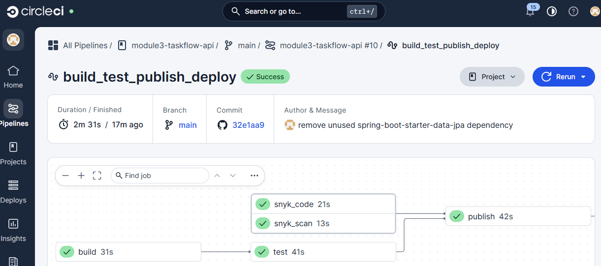
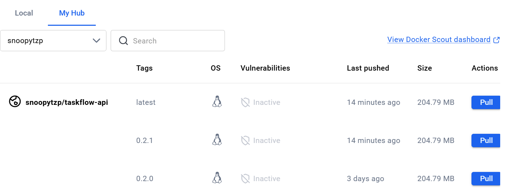
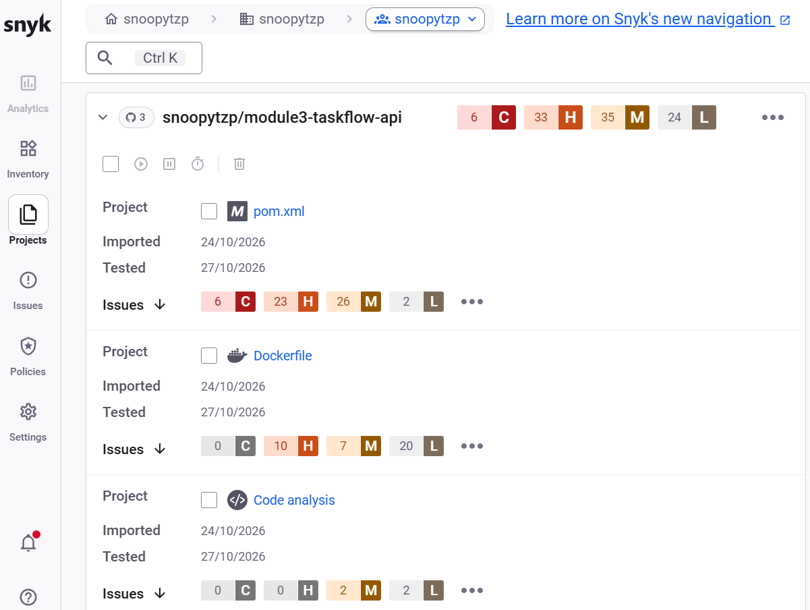
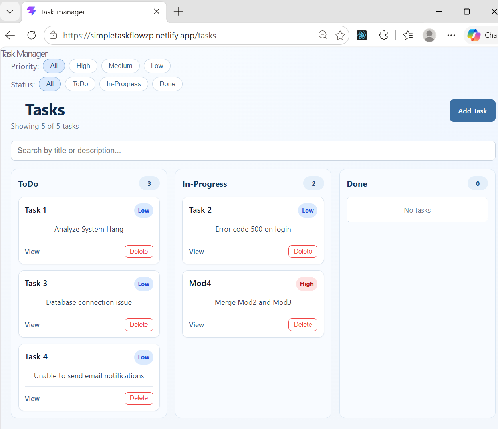

# TaskFlow

TaskFlow is a React task manager website backed by a separately deployed REST API.
It demonstrates a full-stack application and a CI/CD deployment pipeline. Users
can create, view, update, and delete tasks, each with a title, description,
status, and priority.

## Live application

- **Task manager website:** [simpletaskflowzp.netlify.app](https://simpletaskflowzp.netlify.app/)
- **Backend API:** [devops-demo-production-707c.up.railway.app](https://devops-demo-production-707c.up.railway.app/)
- **Task API endpoint:** [`/api/tasks`](https://devops-demo-production-707c.up.railway.app/api/tasks)
- **Frontend hosting:** Netlify
- **Backend hosting and PostgreSQL database:** Railway

The React frontend and backend API are deployed as separate services. This
repository contains the backend API source; the React website is hosted
independently on Netlify.

## Features

- Create tasks with a title, description, status, and priority.
- View all tasks or a single task.
- Amend an existing task.
- Delete a task.
- Mark a task as complete.
- Filter and search tasks in the task manager website.
- Generate an AI summary of the task list.

Task statuses are `todo`, `in-progress`, and `done`. Priorities are `low`,
`medium`, and `high`. The API defaults new tasks to `todo` status and `low`
priority.

## CI/CD and deployment

CircleCI runs the `build_test_publish_deploy` workflow:

1. **Build** the backend API.
2. **Test** it against PostgreSQL.
3. **Scan** dependencies and source code with Snyk.
4. **Publish** Docker images to Docker Hub after the tests and scans complete.
5. **Deploy** the latest image to Railway.

The pipeline uses Docker Hub image tags following
`<major>.<new-feature>.<bug-fix>`, for example `0.2.0` and `0.2.1`, as well as
the mutable `latest` tag. The versioned tag identifies a specific image, while
`latest` points to the most recently published image.



### Docker image versioning

The Docker Hub repository contains versioned images as well as `latest`.



### Security scanning

Snyk dependency and code scans are part of the CI/CD workflow. The following
screenshot shows an initial scan and its reported findings; scan results can
change as dependencies and source code change. Review findings, upgrade or
otherwise remediate affected components, then run the pipeline again to verify
the result. The dependency scan is configured not to fail the build on findings,
so a successful pipeline does not by itself mean that all findings are fixed.



## Task manager website

The website presents tasks in columns by status and provides priority filters,
search, and task creation, viewing, and deletion controls.



## REST API

All task endpoints use the `/api/tasks` base path.

| Method | Path | Description | Success |
| --- | --- | --- | --- |
| `GET` | `/api/tasks` | List tasks | `200 OK` |
| `GET` | `/api/tasks/{id}` | Get a task | `200 OK` |
| `POST` | `/api/tasks` | Create a task | `201 Created` |
| `PUT` | `/api/tasks/{id}` | Update a task | `200 OK` |
| `DELETE` | `/api/tasks/{id}` | Delete a task | `200 OK` |
| `PUT` | `/api/tasks/{id}/complete` | Mark a task as complete | `200 OK` |
| `GET` | `/api/tasks/summary` | Generate an AI task summary | `200 OK` |

Example request:

```bash
curl -X POST https://devops-demo-production-707c.up.railway.app/api/tasks \
  -H 'Content-Type: application/json' \
  -d '{
    "title": "Review pull request",
    "description": "Check the API changes",
    "status": "todo",
    "priority": "medium"
  }'
```

Task responses contain `id`, `title`, `description`, `status`, and `priority`.
Titles and descriptions are required. Status and priority values must use the
lowercase options shown above.

## Architecture and configuration

- **Frontend:** React task manager website, deployed on Netlify.
- **Backend:** REST API deployed on Railway; the frontend calls this service
  for task operations.
- **Database:** PostgreSQL provisioned by Railway and used by the backend.
- **Delivery pipeline:** CircleCI builds and tests the API, runs Snyk scans,
  publishes Docker images, and triggers the Railway deployment.

The React frontend source is maintained separately from this API repository.
Frontend-specific local development instructions belong with that source. For
the deployed app, use the website and API links above.

The backend uses environment-based database credentials and an API key for the
AI summary integration. Keep deployment credentials and API keys in environment
variables or deployment secrets; never commit real credentials to source
control.
